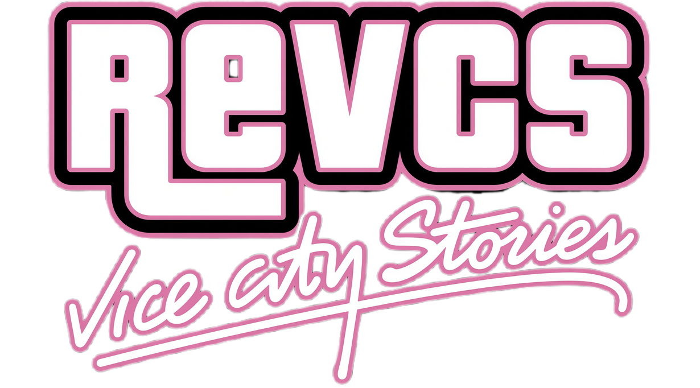

# reVCS Manager

Install **reVCS Alpha 0.55** on Windows using your own Vice City Stories PS2 ISO or extracted disc folder.

[Download Manager 1.35.12](https://github.com/DasIstEin20/reVCS_Installer/releases/download/v1.35.12/reVCS-Manager-1.35.12-bootstrap.zip) · [All downloads](https://github.com/DasIstEin20/reVCS_Installer/releases/tag/v1.35.12) · [Website](https://dasistein20.github.io/reVCS_Installer/)

**Manager 1.35.12** adds source-resolution texture imports, pack review filters, a native save editor and `-nointro`. Fresh conversion installs Update 8.8 directly. [Changelog](releases/CHANGELOG-1.35.12.md)

**Update 8.8** is cumulative for **8 / 8.0 through 8.7**, including the first public installer. Improves Bullet driving, boats, garages, combat poses, menu controls, fonts and anti-aliasing. Includes x86/x64 builds of DX9/DX11. [Changelog](releases/CHANGELOG-8.8.md) · [Update release](https://github.com/DasIstEin20/reVCS_Installer/releases/tag/v0.55-update8.8)

Update Manager to **1.35.12 first**, then apply the cumulative ZIP through Manager. Keep your own PS2 ISO available when new resources need conversion. This update uses verified asset deltas and is not a standalone game.

Requires **Windows 10 or 11, 64-bit**, and your own PS2 game files.

1. Download and extract the bootstrap ZIP into a writable folder.
2. Run `reVCS Manager.exe`. Keep the included `tools` folder beside it.
3. Select your PS2 ISO or extracted disc folder and a new or empty installation folder.
4. Manager downloads and verifies converter components, then converts your own PS2 game files.
5. Fresh conversion installs Update 8.8 directly. Choose native x64 Direct3D 11 (recommended), x86 Direct3D 9, or optional x86 DXVK/Vulkan.
6. Existing installations use **Check Game Updates** for the cumulative package. Update Manager first for current texture-pack support.

For **offline installation**, download all 13 BIN files from the same release and place them beside Manager and `version.xml`. Existing installations at Update 8–8.5 can use the separate cumulative game ZIP offline. Your original ISO, saves and supplied texture archives remain unchanged. Texture packs are supplied separately.

Startup checks offer Manager updates first. Downloads and installation require confirmation. Choose your interface language in the title bar; technical diagnostics and some extended explanations retain English fallback. Online access, cache cleanup and backup preferences remain configurable.

Fresh installations use the backend selected during installation; Quick defaults to x64 Direct3D 11. Existing launch preferences remain. DXVK is optional for the x86 Direct3D 9 fallback. After changing packs, restart the game. Apply unchanged selections to upgrade older imported textures to full offline mip chains.

[Installation guide](releases/INSTALLATION-1.35.12.txt) · [SHA256 checksums](releases/SHA256SUMS-1.35.12.txt) · [Report an issue](https://github.com/DasIstEin20/reVCS_Installer/issues)

No PS2 disc image or third-party replacement pack is included. reVCS is an alpha fan project, free and unaffiliated with Rockstar Games or Take-Two Interactive. See [NOTICE.md](NOTICE.md).
